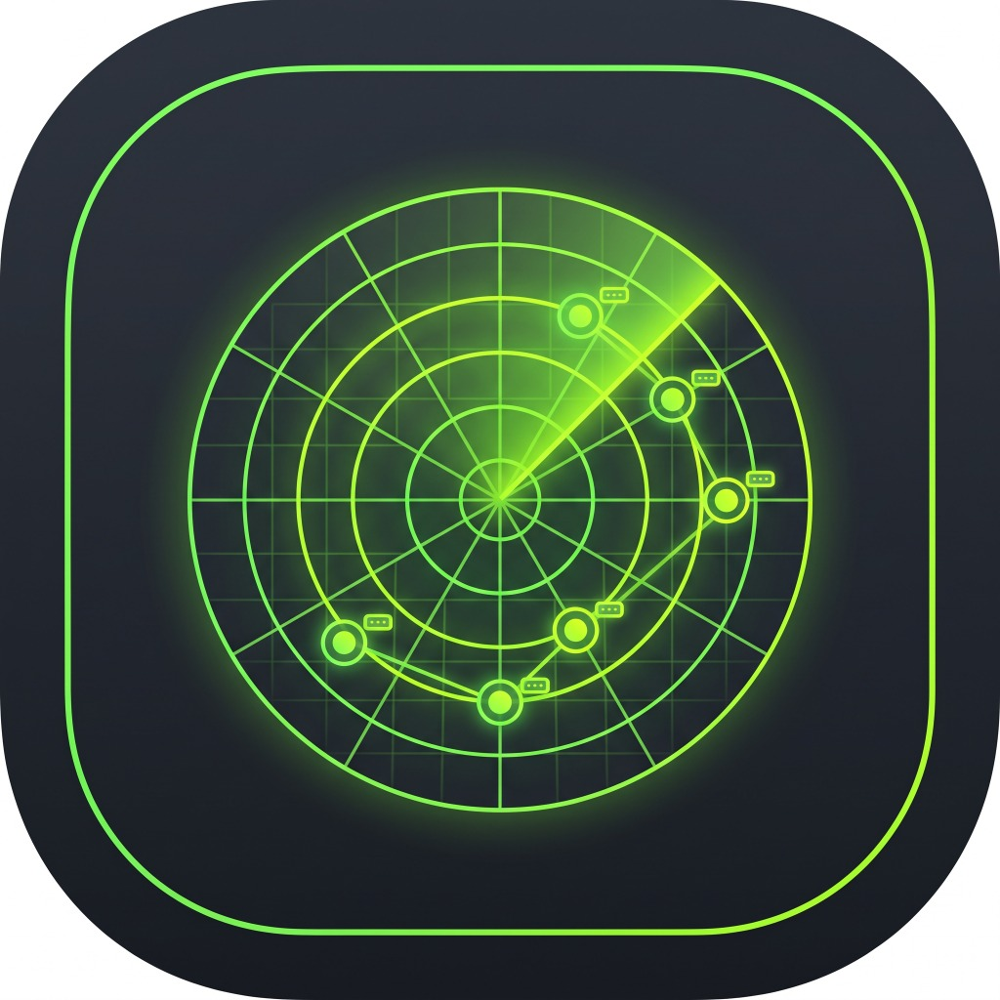

# ARP & Subnet Scout (L2/L3 Discovery & Conflict Detector)

<p align="center">
  
</p>

A high-performance, dark-first desktop network diagnostic tool built with **Flutter Desktop** and an in-memory **SQLite (`sqlite3`)** state engine.

Designed for network engineers, sysadmins, and security analysts troubleshooting unmanaged or misconfigured switches, rogue static devices, and VLAN IP collisions in real time.

---

## Key Features

- **Rapid L2/L3 Subnet Discovery**: Executes concurrent asynchronous ICMP echo sweeps across target CIDRs (e.g. `/24`, `/26`) and IP ranges (e.g. `192.168.1.1-50`) to populate kernel ARP caches, measure RTT latency, and fingerprint operating systems via TTL.
- **Kernel ARP Cache Harvester**: Reads and parses OS L2 ARP tables (`arp -a` on Windows, `arp -an` / `ip neigh` on Linux and macOS) to instantly map IP-to-MAC associations.
- **Real-Time IP Address Conflict Engine**: Automatically tracks MAC-to-IP mappings across consecutive sweeps. When two distinct physical MAC addresses claim the same IPv4 address, the application instantly flags an **`IP CONFLICT`**, merges all competing MACs, surfaces a high-visibility global warning banner, and provides one-click conflict isolation.
- **Multi-Homed MAC Correlation**: Highlights physical hardware adapters and VIPs claiming multiple IP addresses across the subnet.
- **Offline IEEE OUI Hardware Identification**: Comprehensive built-in database identifying enterprise vendors (Cisco, Arista, Juniper, Fortinet, Ubiquiti, MikroTik, Palo Alto, HPE/Aruba, VMware, Proxmox, Dell, Synology, Axis, Hikvision, Raspberry Pi, Espressif, etc.), VRRP/HSRP virtual router MACs, and Locally Administered / Randomized MACs (LAA).
- **Format-Agnostic MAC & Numeric IPv4 Filtering**:
  - Filter by MAC using any notation: `00:50:56`, `00-50-56`, `0050.56`, or raw hex.
  - 32-bit numeric IPv4 indexing ensures natural mathematical sorting (`192.168.1.2` before `192.168.1.10`).
- **5-Tier Desktop Architecture**:
  1. **Top Control Bar**: Interface selector, subnet presets dropdown, Sweep Subnet, instant ARP cache read, continuous 15s Watch Mode, demo subnet loader, and conflict test injector.
  2. **Alert Banners**: Live sweep progress indicators and IP Conflict triage alert.
  3. **Filter Toolbar**: Unified search, dedicated monospace IP/MAC inputs, and live SQLite status count chips.
  4. **High-Density Virtualized Table**: Resizable columns, conflict badges, and rich right-click context menus.
  5. **3-Mode Detail Inspector**:
     - *Summary & Conflict Breakdown*: Side-by-side diagnostic cards for competing MACs and hardware vendors.
     - *ARP Frame Hex Inspector*: 16-byte-per-line canonical Hex + ASCII dump of synthetic Ethernet II + ARP reply frames.
     - *CLI & Raw ARP*: Generated CLI execution string preview card with one-click copy.
- **Import & Export**: Full CSV and JSON export, plus CSV import with conflict-preserving merge.
- **Clean Process Lifecycle**: Hooks into `WidgetsBindingObserver.didRequestAppExit` to ensure zero orphaned ping or ARP subprocesses on window close.

---

## Architecture

Follows the canonical architecture from `UI_AND_DESIGN_PRINCIPLES.md`:

```
lib/
├── data/
│   ├── models/
│   ├── repositories/
│   │   └── arp_repository.dart
│   └── services/
│       ├── database/
│       │   └── arp_database_service.dart     # SQLite in-memory relational state & conflict detection
│       ├── export/
│       │   └── export_service.dart           # CSV & JSON export
│       ├── generator/
│       │   └── demo_arp_generator.dart       # Realistic 35-host enterprise demo topology
│       ├── import/
│       │   └── csv_import_service.dart       # CSV import & parsing
│       ├── network/
│       │   └── network_adapter_service.dart  # IPv4 network interface enumeration
│       ├── oui/
│       │   └── oui_lookup_service.dart       # IEEE OUI hardware vendor resolver
│       └── scanner/
│           └── subnet_scanner_service.dart   # Concurrent ICMP pings & ARP table parser
├── domain/
│   └── models/
│       ├── arp_filter.dart
│       ├── arp_host_record.dart
│       ├── host_status.dart
│       ├── network_adapter_info.dart
│       └── scan_progress.dart
└── ui/
    ├── features/
    │   └── scout/
    │       ├── view_models/
    │       │   └── arp_scout_view_model.dart
    │       └── views/
    │           ├── arp_control_bar.dart
    │           ├── arp_detail_panel.dart
    │           ├── arp_filter_bar.dart
    │           ├── arp_scout_screen.dart
    │           └── arp_table_view.dart
    └── theme/
        └── app_theme.dart                    # Material 3 Dark theme (#141414 / #1E1E1E / #007ACC)
```

---

## Building and Running

### Prerequisites
- Flutter SDK (3.13+)
- Windows 10/11, macOS, or Linux desktop environment
- C++ build tools (Visual Studio 2022 on Windows)

### Run in Debug Mode
```powershell
flutter run -d windows
```

### Run Tests
```powershell
flutter test
```

### Build Windows Release Executable
```powershell
flutter build windows
```
The compiled standalone binary is generated at:
```
build/windows/x64/runner/Release/arp_scout.exe
```

---

## License
MIT License.
